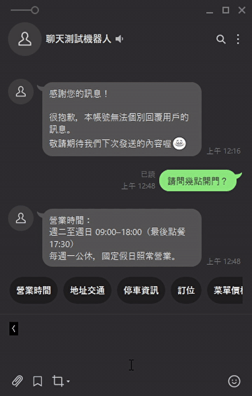
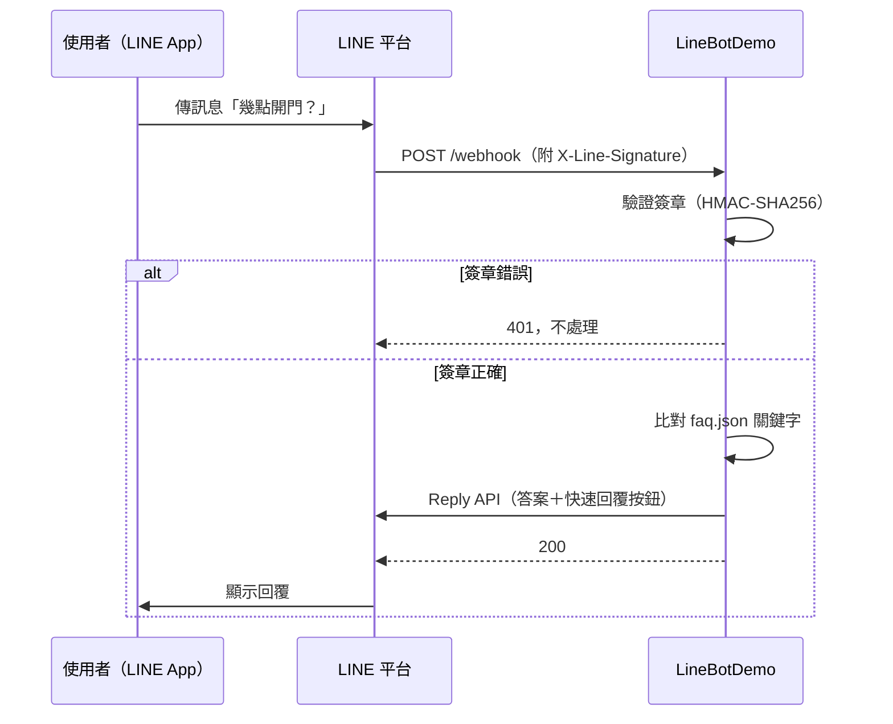

# linebot-demo：LINE 官方帳號自動回覆機器人

[](https://github.com/Marc-YULIN/linebot-demo/actions/workflows/ci.yml)  

ASP.NET Core (.NET 10) LINE Messaging API bot demo: webhook signature verification, keyword and FAQ replies, quick-reply buttons.

用 ASP.NET Core 做的 LINE Bot 示範：驗證 LINE 簽章、依關鍵字回答常見問題，每則回覆都附快速回覆按鈕。示範店家是虛構的「森林咖啡」。

## 解決什麼問題

- 客人常在 LINE 上問同樣的問題（幾點開、在哪裡、能不能帶狗），老闆要一直重複回答
- 下班時間沒人回，客人等不到答案
- LINE 內建的關鍵字回覆比對太死板，而且不好維護

這個機器人 24 小時自動回答，**店家只要改一個 `faq.json` 檔就能更新回覆內容**，存檔後立即生效，不用重開程式。

## 操作畫面



實際在 LINE 上對話的錄影。

| 使用者輸入 | 機器人回覆 |
|---|---|
| 請問幾點開門？ | 營業時間：週二至週日 09:00–18:00… |
| 可以帶狗嗎 | 歡迎毛小孩！請全程牽繩或放推車… |
| 說明 | 列出所有可以問的問題 |
| （點下方「停車資訊」按鈕） | 店門口可停機車… |
| 你們老闆是誰 | 抱歉，這個問題我還不會回答…（附常見問題按鈕） |
| （傳貼圖） | 目前我只看得懂文字訊息喔～ |

## 運作流程



## 功能重點

- **簽章驗證**：用 channel secret 對原始請求內容做 HMAC-SHA256，並用固定時間比較，擋掉偽造的請求
- **FAQ 比對**：點按鈕送來的主題優先；打字問的依命中的關鍵字評分，選最符合的一題
- **快速回覆按鈕**：每則回覆都附常見問題按鈕，客人不用打字（符合 LINE 最多 13 個、20 字的限制）
- **改內容不用重開**：`faq.json` 存檔後自動重新載入
- **穩定**：單一事件回覆失敗不影響其他事件；LINE 後台的「Verify」可直接通過
- **密鑰不進程式碼**：只從 user-secrets 或環境變數讀取，缺少時啟動就失敗並用中文說明
- **隱私**：日誌只記錄回覆類型與命中的題目，不記錄使用者 ID 與訊息內容
- **有測試**：簽章、回覆邏輯、整個 webhook（WebApplicationFactory）共 31 個測試

## 本機測試步驟

需要 [.NET 10 SDK](https://dotnet.microsoft.com/download) 與一個 LINE 官方帳號。

### 1. 建立 LINE Messaging API channel

1. 到 [LINE Developers Console](https://developers.line.biz/console/) 建立 Provider 與 Messaging API channel
2. **Basic settings** 分頁複製 **Channel secret**
3. **Messaging API** 分頁最下方發行 **Channel access token (long-lived)**
4. 到 [LINE Official Account Manager](https://manager.line.biz/) 的回應設定，關閉「自動回應訊息」，避免和機器人重複回覆

### 2. 設定密鑰（不會進 git）

```bash
git clone https://github.com/Marc-YULIN/linebot-demo.git
cd linebot-demo

dotnet user-secrets set "Line:ChannelSecret" "<你的 channel secret>" --project src/LineBotDemo
dotnet user-secrets set "Line:ChannelAccessToken" "<你的 channel access token>" --project src/LineBotDemo
```

### 3. 啟動程式

```bash
dotnet run --project src/LineBotDemo
# Now listening on: http://localhost:5080
```

### 4. 讓 LINE 連得到本機（二選一）

**Dev Tunnels**（微軟提供，[安裝說明](https://learn.microsoft.com/azure/developer/dev-tunnels/get-started)）：

```bash
devtunnel user login
devtunnel host -p 5080 --allow-anonymous
```

**ngrok**（[安裝說明](https://ngrok.com/download)）：

```bash
ngrok http 5080
```

### 5. 設定 Webhook

1. 回到 LINE Developers Console 的 **Messaging API** 分頁
2. **Webhook URL** 填入上一步取得的網址加上 `/webhook`，例如 `https://xxxx.devtunnels.ms/webhook`
3. 按 **Verify**，顯示 Success 即可
4. 開啟 **Use webhook**
5. 用手機加官方帳號好友，傳「說明」試試看

### 執行測試

```bash
dotnet test
```

## 修改回覆內容

編輯 `src/LineBotDemo/faq.json`，存檔後立即生效：

```json
{
  "Title": "營業時間",
  "Keywords": [ "幾點", "開門", "營業", "公休" ],
  "Answer": "營業時間：\n週二至週日 09:00–18:00"
}
```

- `Title`：問題主題，也是按鈕上的文字
- `Keywords`：訊息包含任一關鍵字就算命中
- `Answer`：回覆內容，`\n` 是換行

同一個檔案也可以改歡迎詞（`Welcome`）、看不懂時的回覆（`Fallback`）。

## 部署

可部署到 Azure App Service、任何支援 .NET 的主機或 Docker。密鑰用環境變數設定：

| 環境變數 | 內容 |
|---|---|
| `Line__ChannelSecret` | Channel secret |
| `Line__ChannelAccessToken` | Channel access token |

## 專案結構

```text
src/LineBotDemo/
  Program.cs                    設定、POST /webhook
  faq.json                      回覆內容（店家可自行修改）
  Line/LineSignatureValidator.cs  X-Line-Signature 驗證
  Line/LineMessagingClient.cs     呼叫 LINE Reply API
  Line/LineModels.cs              webhook 與訊息資料結構
  Bot/ReplyEngine.cs              決定回覆內容
  Bot/WebhookHandler.cs           處理各種事件
tests/LineBotDemo.Tests/
```

## 可客製成什麼服務

- **關鍵字自動回覆＋圖文選單**：小店、工作室、補習班的常見問題
- **AI 客服**：串接 OpenAI 或 Claude，依店家的 FAQ 與文件回答自由提問
- **預約／訂單查詢**：串接 Google Sheets 或資料庫，客人在 LINE 上查自己的預約與訂單
- **主動通知**：出貨、到貨、預約提醒用 LINE 推播

LINE 官方帳號月費、AI 使用費、主機費依各家方案計價，上線前可先試算。

## 授權

[MIT](LICENSE)
